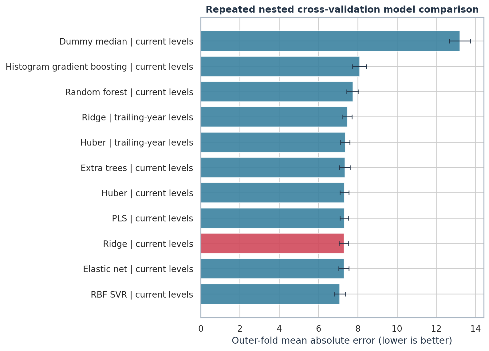

# SoCal ZIP-by-Time Market Score

An end-to-end, leakage-safe scoring workflow that assigns a bounded 0-100 market score to each Southern California ZIP code and period. It covers latest-2025 calibration, full-period scoring, temporal validation, feature interpretation, and geographic distribution-shift diagnostics.

The score is contemporaneous and descriptive. It is not a forecast or a causal estimate.

## Results at a glance

| Item | Result |
| --- | ---: |
| Selected model | Ridge regression on current-period ranks |
| Usable reference ZIPs | 83 |
| Repeated nested-CV MAE | 7.17 points |
| Repeated nested-CV RMSE | 9.75 points |
| Repeated nested-CV R-squared | 0.649 |
| Repeated nested-CV Spearman correlation | 0.826 |
| Leave-one-city-out R-squared | 0.433 |
| Latest eligible 2025 ZIPs scored | 524 |
| Existing ZIP-period rows scored | 12,445 |

The selected Ridge model was chosen with a one-standard-error rule after comparing regularized linear, robust linear, latent-component, kernel, random-forest, extra-trees, and gradient-boosting candidates under repeated nested cross-validation. See [REPORT.md](REPORT.md) for methodology, evidence, limitations, and source links.



## Repository structure

```text
.
├── data/raw/                 # Two-sheet source workbook
├── figures/                  # Result and diagnostic visuals
├── notebooks/               # Executed end-to-end Jupyter notebook
├── outputs/                  # Score CSVs, diagnostics, metrics, and model bundle
├── scripts/                  # Notebook builder
├── src/socal_market_score/   # Data, modeling, reporting, and workflow modules
├── tests/                    # Output-contract and reproducibility tests
├── run_analysis.py           # Command-line workflow entry point
├── REPORT.md                 # Technical write-up
└── requirements.txt          # Pinned Python dependencies
```

## Reproduce the analysis

Python 3.12 is recommended.

```bash
python3 -m venv .venv
.venv/bin/pip install -r requirements.txt
.venv/bin/python run_analysis.py
.venv/bin/python scripts/build_notebook.py
.venv/bin/python -m unittest discover -s tests
```

The workflow reads the source workbook from `data/raw/`, writes tabular artifacts to `outputs/`, writes charts to `figures/`, and refreshes `REPORT.md`. Randomness is fixed at seed 42.

## Modeling design

- Uses the latest available 2025 record separately for each ZIP.
- Converts 12 contemporaneous market-level features to cross-sectional percentile ranks within each exact period end, reducing nominal market drift and outlier sensitivity.
- Learns median imputation, scaling, and model parameters inside scikit-learn pipelines to prevent validation leakage.
- Uses five repeats of five-fold outer cross-validation with four-fold inner tuning.
- Produces honest repeated out-of-fold predictions for the reference-ZIP evaluation file.
- Clips every delivered score to the 0-100 interval.
- Tests alignment with days on market, sale-to-list ratio, sold-above-list share, inventory, and a list-price-drop proxy.
- Quantifies temporal stability and reference-to-deployment covariate shift.

No external market dataset is used. External sources cited in the report support methodology choices only.

## Main outputs

- `outputs/scores_latest_select_zips_eval.csv`
- `outputs/scores_latest_all_zips.csv`
- `outputs/scores_all_periods.csv`
- `notebooks/socal_market_score_model.ipynb`
- `REPORT.md`
- `figures/top_bottom_latest.png`
- `figures/score_trend_example.png`
- `figures/feature_importance.png`
- `figures/distribution_shift.png`

## Important limitations

Only 83 usable labels are available, concentrated in six cities. The repeated nested-CV result is solid for a dataset of this size, but the lower leave-one-city-out result shows meaningful geographic transport risk. The fitted relationships are associative, and cross-sectional percentile ranks require a contemporaneous ZIP cohort when scoring a new period.

## License

The code is released under the [MIT License](LICENSE). The source workbook in `data/raw/` is not covered by this license.
